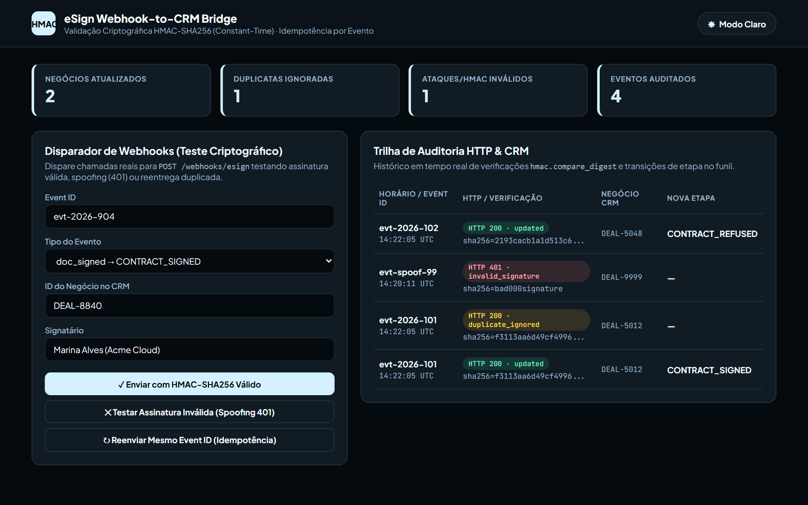

# eSign Webhook-to-CRM Bridge



Microserviço HTTP + **Console Criptográfico Web** em Python que recebe webhooks de plataformas de assinatura eletrônica (`doc_signed`, `doc_refused`, `doc_expired`), **valida a autenticidade criptográfica via HMAC-SHA256** (comparação em tempo constante contra *timing attacks*), aplica idempotência por `event_id` e atualiza automaticamente a etapa do negócio no CRM.

## Recursos

- **Segurança Criptográfica:** valida o cabeçalho `X-Webhook-Signature` usando `hmac.compare_digest` antes de aceitar qualquer payload.
- **Idempotência de Eventos:** ignora reentregas duplicadas do provedor de webhooks sem repetir transições no CRM.
- **Mapeamento Declarativo de Etapas:** traduz eventos de assinatura para estágios do funil (`CONTRACT_SIGNED`, `CONTRACT_REFUSED`, `FOLLOWUP_EXPIRED`).

## Como Executar

```bash
# Inicia o servidor HTTP na porta 8095
python -m src.server

# Roda os testes automatizados (assinatura válida, inválida e idempotência)
pytest -v
```
